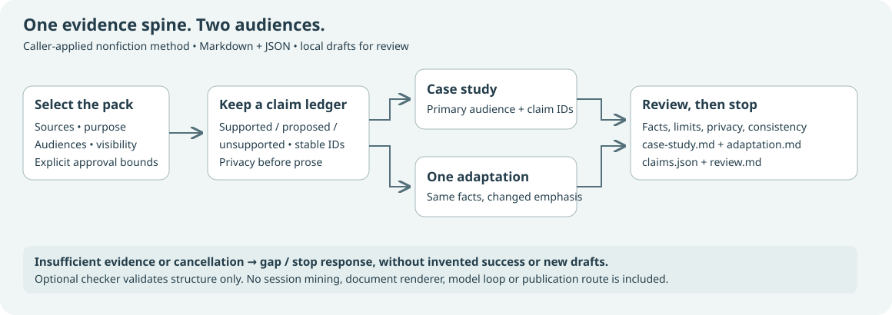

# Stories

Turn selected evidence about documented project work into one sourced case study and one audience adaptation with a shared claim map.

Stories is an MIT-licensed caller-applied method with an optional read-only Python checker. Packaging and fixture checks do not establish writing quality or independent human usefulness. It does not mine sessions, invent impact, create fiction, install renderers, or publish.



Bring a purpose, a primary audience, one adaptation audience, an intended visibility and an explicit evidence pack. The method returns Markdown drafts, `claims.json` and `review.md`. An executive adaptation can state the decision and the uncertainty without inventing ROI. A routine or unsuccessful project can remain a plain account.

## Setup

For direct use, read the canonical `skills/stories/SKILL.md` and keep its resource folder together. No other capability is required. The shared installer below is optional for receipt-backed host discovery.

Use the portfolio's **existing shared canonical installer**; this repository does not carry another copy. Set `CAPABILITY_INSTALLER` to that reviewed script, select an explicit full 40-character commit and a project destination. From a reviewed local checkout, these are the three steps; replace the angle-bracket values rather than pasting them literally:

```sh
cd <stories-checkout>
python3 "$CAPABILITY_INSTALLER" preview --source . --manifest capability.json --revision <FULL_COMMIT> --dest <PROJECT> --harness codex
python3 "$CAPABILITY_INSTALLER" install --source . --manifest capability.json --revision <FULL_COMMIT> --dest <PROJECT> --harness codex --expect-plan <REVIEWED_PLAN_HASH> --apply
```

The installer supports Claude Code, Codex, Gemini, Grok, OpenCode and Amplifier discovery paths; choose the actual host. Copying discovery files does not prove that the host follows the method, install a runtime, or grant permissions. [Install, rollback and compatibility](docs/INSTALL.md) explains the boundaries. Use a reviewed full source commit; installation remains an explicit separate action.

## Try a fictional pack

Ask your compatible agent:

> Use Stories with `evals/dev/repair-club.json`. Make a concise project-team case study and one executive adaptation. Keep visits distinct from people, retain the voluntary feedback denominator, omit private evidence, and do not infer time saved or ROI. Save new local drafts for review; do not publish.

The included fixture and example are fictional. The source’s existing method already handled these evidence constraints in the development baseline. New packaging makes interfaces explicit; it has not established better writing or audience outcomes.

The optional checker needs Python 3.11+ and no packages:

```sh
python3 skills/stories/scripts/check.py packet --input evals/dev/repair-club.json
python3 skills/stories/scripts/check.py output --input evals/dev/repair-club.json --output evals/dev/final
```

It checks IDs, selected-source eligibility and draft/ledger membership. It cannot verify source entailment, detect every uncited claim or private detail, or judge prose quality. Read the claim map and both drafts yourself.

## Review material

- [Method](skills/stories/SKILL.md) and [versioned contract](contracts/README.md)
- [Right Shape placement](docs/RIGHT-SHAPE.md)
- [Frozen benchmark protocol and actual limits](docs/BENCHMARK.md)
- [Source attribution](skills/stories/references/ATTRIBUTION.md) and [MIT license](LICENSE)

Research/Long Read evidence, ArticleCraft article work, Idea Talks talks and Taste review are optional handoffs. This first slice has one adaptation and Markdown/JSON outputs; it contains no autonomous recipe or document-format engine.

## Coordinated guide

The coordinated main-site guide is `https://michaeljabbour.github.io/capabilities/stories/` (setup anchor: `#setup`). The repository owner coordinates that guide with publication. The instructions and workflow above remain self-contained. No separate Pages site is promised.
